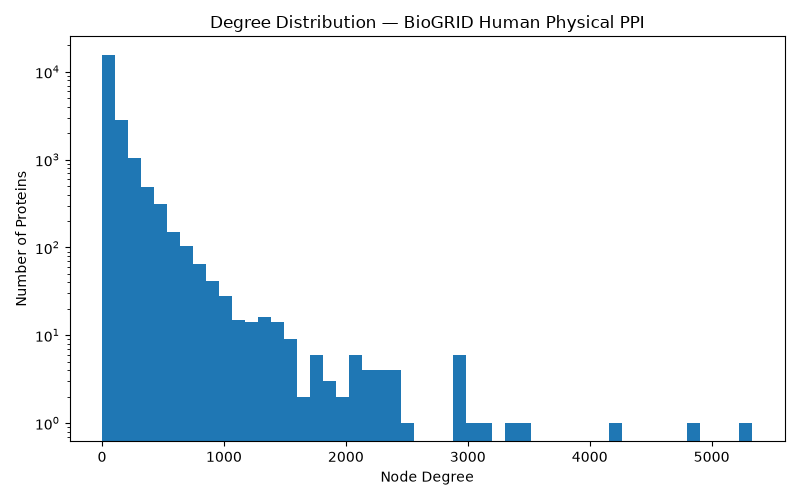
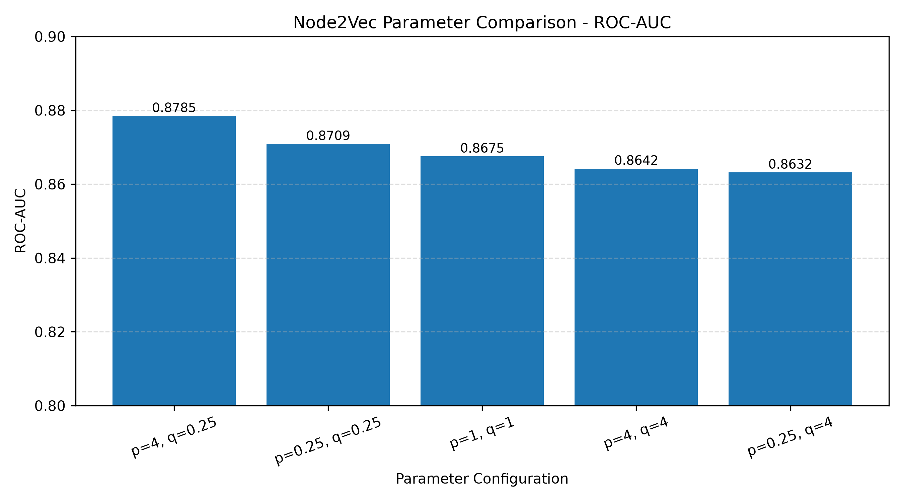
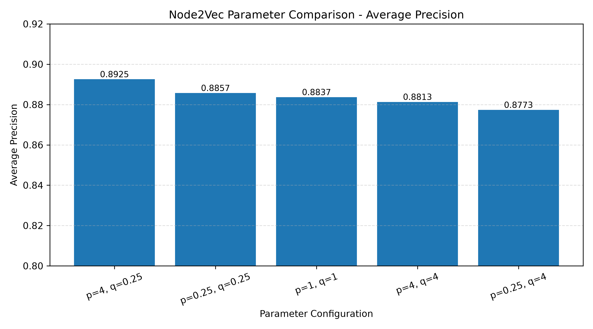

 <div align="center">

# Node2Vec for Link Prediction in Human Protein–Protein Interaction Networks

### How do random-walk parameters **p** and **q** affect the prediction of held-out protein interactions?


**20,890 proteins · 989,498 physical interactions · 5 Node2Vec configurations**

[Results](#key-results) · [Dataset](#dataset-and-network-characteristics) · [Methodology](#methodology) · [Sensitivity Analysis](#parameter-sensitivity-analysis) · [Limitations](#limitations) · [Reproduce](#reproducing-the-experiments)

</div>

---

## Overview

This project evaluates whether **Node2Vec** embeddings can predict held-out **physical protein–protein interactions (PPIs)** in the human interactome, and how sensitive that prediction is to the random-walk bias parameters:

- **p** (return parameter): controls the likelihood of stepping straight back to the previous node
- **q** (in-out parameter): controls whether the walk stays near the previous node or explores outward

Embeddings are trained **only on the training graph** (80% of edges), so no information from the test edges leaks into the representation.

---

## Key Results

| Item | Result |
|---|---|
| Network | 20,890 proteins, 989,498 physical interactions (BioGRID 5.0.263, *Homo sapiens*) |
| Task | Link prediction on 20% of edges withheld from embedding training |
| Edge representation | Hadamard product of node embeddings, scaled, then Logistic Regression |
| Baseline (p = 1, q = 1) | ROC-AUC **0.8675**, Average Precision **0.8837** |
| Best configuration tested | p = 4, q = 0.25: ROC-AUC **0.8785**, Average Precision **0.8925** |
| Gain over baseline | +0.0110 ROC-AUC (+1.26%), +0.0089 AP (+1.01%) |
| Main pattern | Both configurations with q = 0.25 outperformed the baseline; both with q = 4 fell below it |

> **Key takeaway.** Node2Vec embeddings trained only on the training graph separate held-out interactions from non-interacting pairs well (ROC-AUC > 0.86 in all five settings). Random-walk parameters shifted performance by up to about 0.015 ROC-AUC between the best and worst configurations. The effect is consistent in direction but modest in size and rests on a single split and seed.

<div align="center">

| Configuration | ROC-AUC | Average Precision |
|---|:---:|:---:|
| Baseline (p = 1, q = 1) | 0.8675 | 0.8837 |
| **Best tested (p = 4, q = 0.25)** | **0.8785** | **0.8925** |

</div>

---

## Dataset and Network Characteristics

### Source and filtering

The network was built from the human physical PPI data in **BioGRID Release 5.0.263** (organism: *Homo sapiens*, NCBI Taxonomy ID 9606).

**Dataset download:**

- Official source: [BioGRID Downloads](https://downloads.thebiogrid.org/)
- Dataset filename: `BIOGRID-ALL-5.0.263.tab3.zip`
- Dataset format: Tab-delimited text (Tab 3)

Download the archive from the official BioGRID website and extract it. Place the resulting `BIOGRID-ALL-5.0.263.tab3.txt` file inside `data/raw/`.

The preprocessing script retains human physical interactions, extracts Entrez Gene identifiers, removes duplicate undirected edges and self-loops, and generates `ppi_edges_clean.tsv`.

Proteins are identified by Entrez Gene ID; gene symbols have not been mapped.

> Raw dataset files are **not included** in this repository because of their size. Users must download the dataset from the official BioGRID website before running the preprocessing pipeline.

### Network statistics

| Property | Value |
|---|---|
| Proteins (nodes) | 20,890 |
| Unique interactions (edges) | 989,498 |
| Network type | Undirected, unweighted |
| Connected components | 2 |
| Largest component | 20,888 nodes |
| Smaller component | 2 nodes (Entrez IDs 2837 and 257313) |
| Isolated nodes | 0 |
| Self-loops | 0 |
| Network density | 0.004535 |
| Average degree | 94.73 |
| Minimum degree | 1 |
| Maximum degree | 5,335 |

The network is dominated by one giant connected component containing 99.99% of proteins. Random walks remain within their starting connected component and cannot traverse between disconnected components.

### Degree distribution

<div align="center">



*Figure 1. Degree distribution (log-scaled y-axis). The majority of proteins fall in the lowest-degree bins, while a small number of proteins reach degrees above 3,000.*

</div>

The distribution is strongly **right-skewed**. Most proteins have comparatively few interaction partners, and a small set of **hub proteins** have thousands. The most connected protein (Entrez ID 11051) interacts with 5,335 other proteins, which is roughly 25.5% of all other proteins in the network.

<details>
<summary><b>Table 1. Ten highest-degree proteins (click to expand)</b></summary>

| Rank | Entrez Gene ID | Degree |
|---:|---|---:|
| 1 | 11051 | 5,335 |
| 2 | 440730 | 4,834 |
| 3 | 54764 | 4,162 |
| 4 | 5071 | 3,418 |
| 5 | 3609 | 3,383 |
| 6 | 8452 | 3,162 |
| 7 | 6117 | 3,064 |
| 8 | 4609 | 2,986 |
| 9 | 57664 | 2,969 |
| 10 | 25962 | 2,949 |

</details>

**Why this matters.** A skewed degree distribution means random walks visit hubs disproportionately often, and a hub's edges tend to be easier to predict than those of low-degree proteins. Both effects can influence what the embeddings capture and how performance should be interpreted (see [Limitations](#limitations)).

---

## Methodology

### Pipeline overview


| Step | Operation | Output |
|:---:|---|---|
| 1 | Build the filtered human physical PPI network | 20,890 nodes, 989,498 edges |
| 2 | Randomly split edges into training and testing sets using an 80:20 ratio, while preserving at least one training interaction for every protein. | Training graph and held-out test edges |
| 3 | Train Node2Vec on the **training graph only** | 64-dimensional embedding per protein |
| 4 | Sample positive and negative protein pairs | Classifier training and test sets |
| 5 | Build edge features with the Hadamard product | One 64-dimensional vector per pair |
| 6 | Standardise features and fit Logistic Regression | Link prediction classifier |
| 7 | Evaluate on held-out pairs | ROC-AUC and Average Precision |

### Edge split

| Partition | Interactions | Share |
|---|---:|---:|
| Training graph | 791,599 | 80.0% |
| Held-out test edges | 197,899 | 20.0% |
| **Total** | **989,498** | **100%** |

All 20,890 proteins remain present in the training graph, so every test-edge endpoint has an embedding. Embeddings were learned from the training graph only, which prevents information from test edges leaking into the representation.

### Pair sampling for the classifier

| Set | Positive pairs | Negative pairs | Total |
|---|---:|---:|---:|
| Classifier training | 50,000 | 50,000 | 100,000 |
| Testing | 10,000 | 10,000 | 20,000 |

Positive training pairs were drawn from training-graph edges and positive test pairs from held-out edges. Negative pairs are protein pairs with no recorded interaction.

### Model and baseline configuration

| Component | Setting |
|---|---|
| Embedding method | Node2Vec |
| Embedding dimensions | 64 |
| Walk length | 10 |
| Walks per node | 5 |
| Baseline return parameter p | 1 |
| Baseline in-out parameter q | 1 |
| Edge feature operator | Hadamard (element-wise) product, `e(u, v) = z_u ⊙ z_v` |
| Preprocessing | StandardScaler |
| Classifier | Logistic Regression |

### Evaluation metrics

- **ROC-AUC** is the probability that a randomly chosen true interaction is scored higher than a randomly chosen non-interaction. A value of 0.5 is chance and 1.0 is perfect ranking.
- **Average Precision (AP)** summarises the precision–recall curve and rewards placing true interactions at the top of the ranked list.

---

## Baseline Performance

With unbiased walks (p = 1, q = 1):

| Metric | Value |
|---|---:|
| ROC-AUC | **0.8675** |
| Average Precision | **0.8837** |

The classifier ranks a true held-out interaction above a sampled non-interaction in about **87%** of random comparisons. Because the embeddings were trained without ever seeing the test edges, this indicates that the topology of the training network carries substantial information about which protein pairs are likely to interact.

---

## Parameter Sensitivity Analysis

### Design

Four additional (p, q) settings were evaluated alongside the baseline. Dimensions (64), walk length (10), walks per node (5), the train/test split, the sampled pairs and the classifier were held constant, so differences reflect the random-walk bias.

### Results

| Rank | p | q | ROC-AUC | Δ ROC-AUC | Average Precision | Δ AP |
|:---:|:---:|:---:|:---:|:---:|:---:|:---:|
| 1 | 4 | 0.25 | **0.8785** | **+0.0110** | **0.8925** | **+0.0089** |
| 2 | 0.25 | 0.25 | 0.8709 | +0.0034 | 0.8857 | +0.0021 |
| 3 | 1 | 1 *(baseline)* | 0.8675 | — | 0.8837 | — |
| 4 | 4 | 4 | 0.8642 | −0.0033 | 0.8813 | −0.0024 |
| 5 | 0.25 | 4 | 0.8632 | −0.0043 | 0.8773 | −0.0063 |

*Table 2. Link prediction performance by parameter configuration. Δ is the difference from the baseline. Ranking is by ROC-AUC; the AP ordering is identical.*

<div align="center">



*Figure 2. ROC-AUC by configuration. The y-axis starts at 0.80, which magnifies differences visually.*

<br>



*Figure 3. Average Precision by configuration. The y-axis starts at 0.80.*

</div>

### Effect of each parameter

Averaging the two configurations at each level of a parameter gives a simple descriptive view of the 2 × 2 grid:

| Factor | Level | Mean ROC-AUC | Difference |
|---|---|:---:|:---:|
| q | 0.25 | 0.8747 | **+0.0110** in favour of q = 0.25 |
| q | 4 | 0.8637 | |
| p | 4 | 0.8714 | **+0.0043** in favour of p = 4 |
| p | 0.25 | 0.8671 | |

The benefit of a high p depends on q:

| Condition | ROC-AUC gain from raising p from 0.25 to 4 |
|---|:---:|
| q = 0.25 | +0.0076 |
| q = 4 | +0.0010 |

> These averages are descriptive comparisons of the tested configurations and should not be interpreted as statistically significant parameter effects.

### Interpretation

**What p and q control.** In Node2Vec's second-order random walk, p governs the likelihood of stepping straight back to the node just visited, and q governs whether the walk stays near the previous node or moves outward. A **high p** discourages immediate backtracking. A **low q** favours outward, depth-first-like exploration, which produces walks that travel further across the network.

**Observed pattern.**

1. **q had the larger effect.** Both low-q settings beat the baseline and both high-q settings fell below it, giving a q-driven difference of about 0.011 ROC-AUC.
2. **p mattered mainly when q was low.** Raising p added 0.0076 ROC-AUC at q = 0.25 but only 0.0010 at q = 4.
3. **The best configuration combined both tendencies.** p = 4, q = 0.25 pairs reduced backtracking with outward exploration and produced the highest ROC-AUC and AP.

**Plausible explanation.** Walks that avoid backtracking and move outward sample a wider and more varied neighbourhood around each protein. This may give the skip-gram objective richer co-occurrence context in a dense network where the average protein already has about 95 partners. This is a hypothesis consistent with the results. The experiment did not test the mechanism directly.

**Effect size.** The best gain is about +1.3% in ROC-AUC relative to the baseline. The gain is consistent across both metrics, but it is small, and it comes from one split and one seed, so its stability is untested.

---

## Discussion

**Embedding quality.** All five settings exceeded ROC-AUC 0.86 and AP 0.87. Node2Vec captured a large share of the structure that distinguishes interacting from non-interacting pairs, even with a compact 64-dimensional representation and short walks (length 10, five per node).

**Parameter tuning.** The ordering of configurations was identical under ROC-AUC and AP, which strengthens the directional conclusion that low q is favourable on this network. The absolute differences are modest, so the default (p = 1, q = 1) is already a competitive starting point and tuning offers an incremental improvement.

**Relation to the Node2Vec literature.** The original Node2Vec work frames p and q as controls that shift walks between breadth-first-like and depth-first-like behaviour, with the best setting depending on the network and task. The present results fit that framing: the preferred setting on this PPI network leaned towards outward exploration.

**Biological interpretation.** A high link-prediction score shows that interactions follow learnable topological regularities. It does not, by itself, show that a high-scoring pair interacts physically. Predictions would need experimental or independent database support before being treated as candidate interactions.

---

## Limitations

| # | Limitation | Why it matters | Suggested mitigation |
|:---:|---|---|---|
| 1 | **Negatives are assumed, not confirmed.** Unobserved pairs may be real interactions not yet detected or recorded in BioGRID. | Some sampled negatives may represent genuine but unrecorded interactions, introducing label noise and potentially distorting the evaluation metrics. | Use curated negative sets, or evaluate against newer database releases. |
| 2 | **Balanced evaluation (1:1).** Positive and negative pairs were equal in number. | Real interactomes are very sparse (density 0.0045), so precision at natural prevalence would be much lower than reported. | Report results at realistic class ratios and with ranking metrics such as precision at top-k. |
| 3 | **Single split and single seed.** | Variability across splits and seeds is unknown, so small differences between configurations may fall within noise. | Repeat over multiple splits and seeds and report mean ± standard deviation. |
| 4 | **Limited parameter search.** Only five (p, q) settings were tested. | The best setting is the best among those tested, not necessarily the global optimum. Other hyperparameters were fixed. | Extend to a wider grid and vary dimension, walk length and walk count. |
| 5 | **Literature and ascertainment bias.** | Well-studied proteins are over-represented in BioGRID, and hub status may partly reflect research attention. Models can learn this bias. | Evaluate separately for hub and low-degree proteins and test on independent datasets. |
| 6 | **Hub-dominated topology.** Maximum degree is 5,335 versus an average of 94.73. | Degree alone can be predictive of links, so part of the performance may come from degree rather than finer structure. | Compare against degree-based and common-neighbour baselines. |
| 7 | **No baseline methods outside Node2Vec.** | The results show Node2Vec works but not how it compares with alternatives. | Add DeepWalk, LINE and heuristic scores such as Adamic–Adar. |

---

## Conclusion and Future Work

Node2Vec produced informative protein embeddings for link prediction on the BioGRID human physical PPI network. Trained solely on 80% of the interactions, the embeddings supported a classifier that reached **ROC-AUC 0.8675 and AP 0.8837** at baseline settings on held-out interactions.

The parameter sensitivity experiment showed that random-walk bias affects performance. Among the five configurations tested, **p = 4 and q = 0.25** performed best (ROC-AUC 0.8785, AP 0.8925), and a low q was associated with better results across both p values. The improvement is consistent but modest, and the conclusions are limited by a single split and seed and by the small configuration set.

**Recommended next steps**

1. Repeat the experiments across multiple random splits and seeds and report variability.
2. Expand the (p, q) grid and tune dimension, walk length and walk count.
3. Add comparison methods (DeepWalk, LINE, Adamic–Adar, degree-based baselines).
4. Evaluate at realistic positive-to-negative ratios and separately for hub and low-degree proteins.
5. Validate on independently curated interaction resources and map Entrez IDs to gene symbols for biological interpretation.

For the full methodology, results, interpretation and limitations, see [`results_interpretation.md`](results/results_interpretation.md).

---

## Project Structure

```text
Processed/
├── data/
│   └── raw/                         # Downloaded BioGRID dataset (not tracked)
├── results/
│   ├── network_summary.txt
│   ├── degree_summary.txt
│   ├── degree_distribution.png
│   ├── train_edges.tsv
│   ├── test_edges.tsv
│   ├── train_positive.tsv
│   ├── train_negative.tsv
│   ├── test_positive.tsv
│   ├── test_negative.tsv
│   ├── node2vec_train_graph_embeddings.txt
│   ├── node2vec_baseline_metrics.csv
│   ├── node2vec_parameter_sweep.csv
│   ├── roc_auc_comparison.png
│   └── average_precision_comparison.png
├── download_preprocess_biogrid.py
├── network_analysis.py
├── node2vec_experiment.py
├── prepare_link_prediction.py
├── evaluate_node2vec.py
├── parameter_sweep.py
├── final_comparison_plots.py
├── pyproject.toml
├── uv.lock
├── .gitignore
└── README.md
```

<details>
<summary><b>Result files in <code>results/</code> (click to expand)</b></summary>

| File | Contents |
|---|---|
| `network_summary.txt`, `degree_summary.txt` | Network statistics and top-10 hub proteins |
| `degree_distribution.png` | Figure 1 |
| `train_edges.tsv`, `test_edges.tsv` | 80:20 edge split |
| `train_positive.tsv`, `train_negative.tsv` | Classifier training pairs |
| `test_positive.tsv`, `test_negative.tsv` | Evaluation pairs |
| `node2vec_train_graph_embeddings.txt` | 64-dimensional embeddings learned from the training graph |
| `node2vec_baseline_metrics.csv` | Baseline metrics (p = 1, q = 1) |
| `node2vec_parameter_sweep.csv` | Metrics for all five configurations (Table 2) |
| `roc_auc_comparison.png`, `average_precision_comparison.png` | Figures 2 and 3 |

</details>

<details>
<summary><b>Data integrity checks (click to expand)</b></summary>

The exported split files were checked for consistency with the reported counts.

| Check | Outcome |
|---|---|
| Training plus test edges equal the full network (791,599 + 197,899 = 989,498) | Confirmed |
| Overlap between training and test edge sets | 0 edges |
| All 20,890 proteins present in the training graph | Confirmed |
| Every test-edge endpoint has an embedding in the training graph | Confirmed |
| Positive training pairs (50,000) are all training-graph edges | Confirmed |
| Positive test pairs (10,000) are all held-out test edges | Confirmed |
| Sampled negative pairs that are observed edges in the network | 0 |
| Embedding file dimensions | 20,890 proteins × 64 |
| Negative pairs shared between the training and test negative sets | 5 of 10,000 test negatives (0.05%) also occur in the training negative sample; this overlap may introduce minor evaluation leakage. |

</details>

<details>
<summary><b>Derived quantities (click to expand)</b></summary>

| Quantity | Calculation | Value |
|---|---|---|
| Average degree | 2 × 989,498 ÷ 20,890 | 94.73 |
| Network density | 2 × 989,498 ÷ (20,890 × 20,889) | 0.004535 |
| Training share | 791,599 ÷ 989,498 | 80.0% |
| Largest-component share | 20,888 ÷ 20,890 | 99.99% |
| Best vs baseline, ROC-AUC (relative) | (0.878492 − 0.867542) ÷ 0.867542 × 100 | +1.26% |
| Best vs baseline, AP (relative) | (0.892538 − 0.883655) ÷ 0.883655 × 100 | +1.01% |

</details>

---

## Reproducing the Experiments

**Environment**

- Python 3.11
- Dependency management: [uv](https://docs.astral.sh/uv/)

**1. Install dependencies**

```bash
uv sync
```

**2. Download the dataset**

Download `BIOGRID-ALL-5.0.263.tab3.txt.zip` from the [official BioGRID Downloads page](https://downloads.thebiogrid.org/).

Extract the archive and place `BIOGRID-ALL-5.0.263.tab3.txt` inside:

```text
data/raw/
```

**3. Preprocess the dataset**

Run from the project root:

```bash
uv run python download_preprocess_biogrid.py
```

This generates `ppi_edges_clean.tsv` in the project root.

**4. Run network analysis and experiments**

```bash
uv run python network_analysis.py
uv run python prepare_link_prediction.py
uv run python evaluate_node2vec.py
uv run python parameter_sweep.py
uv run python final_comparison_plots.py
```

These steps reproduce the network analysis, train/test split, baseline evaluation, parameter sensitivity analysis and comparison plots.

The original BioGRID dataset must be downloaded separately and is not included in this repository.

---

## References

- Grover, A., & Leskovec, J. (2016). *node2vec: Scalable Feature Learning for Networks*. Proceedings of the 22nd ACM SIGKDD International Conference on Knowledge Discovery and Data Mining.
- BioGRID: <https://thebiogrid.org/> (Release 5.0.263, *Homo sapiens*, Taxonomy ID 9606, physical interactions)

## AI Use Disclosure

OpenAI ChatGPT (GPT-6) & Claude (opus 4.8) was used as an AI assistance tool during this project for technical guidance, Python code troubleshooting, debugging, documentation refinement, and feedback on project structure and presentation of results.

The implementation, experimental decisions, validation of results, and final scientific interpretations were reviewed by the author. The research synopsis and biological interpretation represent the author's own understanding and work.
